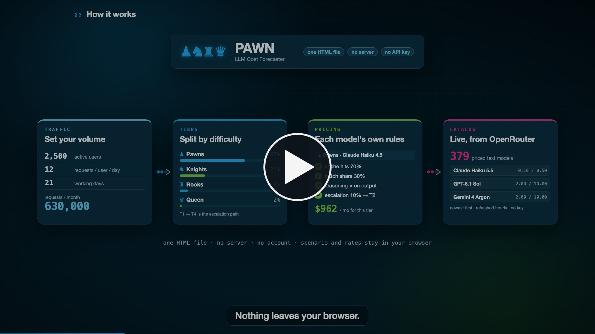

# PAWN LLM Cost Forecaster

[](https://ericediger.github.io/pawn/media/pawn-explainer.mp4)

**[▶ Watch the 2-minute explainer](https://ericediger.github.io/pawn/media/pawn-explainer.mp4)** · **[Try the live demo](https://ericediger.github.io/pawn/demo.html)**

**[▶ Try the live demo](https://ericediger.github.io/pawn/demo.html)** — the full app with the OpenRouter catalog as captured on October 15, 2026; nothing is saved and no key is needed.

The refresh problem was model discovery: the original application only repriced its 14 bundled records. It never added new models. Version 1.0 discovers priced text models across OpenRouter providers, refreshes selected models safely, and keeps a local fallback. It remains a single HTML application with no runtime dependencies or API keys.

## Run and verify

Open `index.html` directly, or use `npm start` and open [the local app](http://127.0.0.1:8765). The local server uses Python 3 and binds only to this computer. Node.js 18 or later is needed for the development checks; there are no packages to install.

1. Open **Discover models**. The application fetches the public catalog if there is no successful snapshot less than one hour old.
2. Search for a model or select a provider. Sort by date added to OpenRouter, price, or name. **Show 50 more** expands the results.
3. Select any discovered model directly in the top **Baseline model** menu or a tier's **Model** menu. The full catalog appears automatically, grouped by provider with newest additions first. Selection adds the model's rates to the active rate card and saves the choice; **Add model** in Discover models remains available for comparing rates without changing a selection. Refreshing the catalog preserves existing selections and the traffic mix.
4. Edit a rate, then choose **Refresh models & prices**. The manual model remains unchanged. **reset** restores the latest available source for that model; **Reset overrides to source rates** does this for all linked models. Unlinked custom models remain manual.
5. Reload: the scenario, pins, overrides, and last successful catalog return from browser storage. Save JSON for a portable backup. Old version 1 and version 2 scenario files are accepted after validation; malformed files leave the current scenario intact.

Automatic refresh checks run every minute while the tab is visible and fetch when the last successful retrieval is at least one hour old. Bringing the tab back into view or reconnecting checks again. Failed automatic attempts wait at least five minutes before retrying. The button always allows an immediate retry. Requests time out after 20 seconds.

This static app does not run while the browser is closed. Browser storage is specific to the origin, browser profile, and sometimes the file path; switching between `file://` and the local server does not share storage. If storage is blocked or full, the app continues in memory and reports that limitation after a refresh. Only public model metadata is downloaded; scenario inputs are not sent to OpenRouter.

```sh
npm test
npm run check
node scripts/live-check.mjs
```

`npm test` runs the Node built-in regression suite. `npm run check` checks every inline script's JavaScript syntax and duplicate static HTML IDs. There was no existing lint, TypeScript, build, or test configuration. No new lint package or runtime dependency was introduced. `live-check.mjs` validates the current public catalog and evaluates multiple input sizes and batch settings for every usable record; it can also evaluate an already downloaded complete response:

```sh
node scripts/live-check.mjs review/catalog-2026-10-15.json review/live-catalog-evidence.json
```

## Forensic review of the original implementation

Reviewed October 15, 2026. Scope: every embedded script in `index.html`, the refresh request and its response handling, model selection, provider pricing rules, cost calculations, scenario persistence/import/export, resets, and rendering. The PDF and screenshot in the folder are supporting artifacts, not application code or a data source. No backend, scheduled job, dependency manifest, tests, service worker, or Git repository existed in this folder.

The untouched original is preserved at [review/index.before.html](review/index.before.html). Its SHA-256 is `03ceca9137d67c694a581afc4505f7e0feae14d8cf51b14877e7b5a390feffcf`.

### Evidence and root cause

The original `BUNDLED_MODELS` array at line 513 contained 14 records from three providers, dated June 11, 2026. `refreshRates`, at line 967, fetched the public catalog, indexed it by ID, and iterated **only `state.models`**. Each existing record could match only its exact `orSlug`. There was no discovery, insertion, scheduled refresh, browser persistence, or cache-age check. HTTP/browser caching could affect request freshness, but it was not the cause of the frozen model list.

The October 15 public response contained 463 records. Eleven original slugs matched; three were absent:

- `mistralai/mistral-large-3`
- `mistralai/magistral-medium`
- `mistralai/ministral-3-8b`

Absence establishes that the catalog does not currently expose those exact IDs. It does not establish why they disappeared or justify guessing a replacement ID. The published base and cache fields shared by the 11 matches agreed with the bundled values in this capture. The principal stale information was model coverage and unsupported pricing metadata, rather than a demonstrated blanket change in the old models' prices.

The revised normalizer accepted 456 records: 379 selectable models and 77 `:batch` variants used as pricing metadata. Seven variable-price router aliases advertised negative sentinel prices and were excluded. Example newly discoverable IDs included `openai/gpt-6.1-sol`, `openai/gpt-6-astra`, `anthropic/claude-fable-5.1`, and `google/gemini-4-argon`. Counts and membership will change with the upstream catalog. Machine-readable evidence is in [review/live-catalog-evidence.json](review/live-catalog-evidence.json). The relevant public fields, including the excluded entries, are preserved in [review/catalog-2026-10-15.json](review/catalog-2026-10-15.json); its server response date is recorded separately from the evaluation time.

### Findings and disposition

Original line references below point to the preserved file.

| Priority | Finding and original evidence | Effect | Resolution |
| --- | --- | --- | --- |
| High | Refresh iterated the fixed list only, lines 967–997. | Every newly released model and every other provider stayed invisible. | Separate catalog discovery across all providers, filtering, sorting, and explicit addition to the active rate card. |
| High | Only input, output, cache read, default cache write, and context were assigned, lines 981–988. One-hour cache and batch prices were retained from June. | A single record could combine live prices with old secondary prices. | Replace the complete token-pricing/rules snapshot for each matched, nonmanual model. Missing optional terms become unknown instead of retaining stale values. |
| High | `parseFloat` checked only the presence of the prompt field, lines 980–982. | Invalid completion prices became `NaN`; negative sentinels or partially numeric strings could enter calculations. Four-decimal rounding erased sufficiently small prices. | Strict finite nonnegative parsing, valid zero prices, precision preservation, and whole-response validation before commit. |
| High | Unknown cache write prices were set to zero inside `priceStream`, lines 353–356. | Written tokens could become free and look like savings. Reproduction: 1,000 requests × 1,000 input tokens at $2/M, 100% writes, unknown one-hour rate produced **$0**, while uncached input cost $2. | Ordinary input rate is used for an unknown write rate, with a warning that extra write charges may apply. |
| High | Provider-wide `AP`, `OA`, and `MI` objects and v1 migration guessed caching/batch behavior, lines 470–497 and 503–505. | New models inherited assumptions that could no longer hold. | Live rules follow each model's fields. New custom models and v1 imports receive no invented batch discount. Default write duration is identified separately from a one-hour rate. |
| High | Batch scaled cached input by the ordinary input discount ratio, lines 367–380. | Assumed cache/batch stacking even where cache prices or eligibility differed. | Use the exact model's published `:batch` variant and its separate cache prices. Without published batch cache terms, use the batch ordinary input rate and warn. Legacy provider discount assumptions remain explicitly estimates. |
| High | Conditional pricing metadata was ignored; one hard-coded GPT warning was the only long-context treatment, line 766. | Long prompts could be underpriced and new thresholds were missed. | Context-only overrides are applied to the whole request when input tokens strictly exceed the threshold, including escalated input. Later overrides win per field. Unmodeled conditions are flagged. |
| Medium | `requiredFieldsOK`, lines 962–965, considered only cache read/default write presence. | “Refreshed” could imply completeness despite missing batch/one-hour terms. The rate-card heading always showed the June date. | Status says **Live token rates**, records retrieval time/source, and lists modeling limits. CSV exports include per-model provenance and catalog retrieval time. |
| Medium | No timeout, deduplication, pagination, or cancellation, lines 967–1006. | Hung requests, races, partial catalogs, or an old response overwriting newly loaded/reset state. | One request at a time; disabled button; timeout; bounded same-endpoint pagination; cancellation and generation checks on load/reset; all-page validation and atomic commit. |
| Medium | Missing models retained old rates, but failures were described broadly as bundled/manual fallback, lines 980 and 1005. | Previously refreshed rates could be mistaken for bundled or current data. | Retain the last usable values and their original timestamps; mark absence explicitly and warn on affected tiers. Failure reports the last successful retrieval. |
| Medium | Scenario state existed only in memory; there was no automatic refresh or persistent cache. | Reload lost current rates and overrides unless the user exported JSON. | Guarded browser storage for the validated scenario and catalog; freshness checks and offline fallback. |
| High | `loadJSON`, lines 939–958, validated only a few top-level values and assigned state before all rendering succeeded. | Invalid nested rules, duplicate IDs, negative/nonfinite prices, broken model references, or pins could crash or corrupt the scenario. | Validate all model prices/rules, unique IDs, globals, tiers, pins, references, and supported versions before replacement; file-size bound; safe failure. |
| High | Imported model IDs were interpolated into option attributes without escaping, line 592; tier piece HTML was also unescaped. | An untrusted scenario file could inject HTML/event attributes. | Escape imported display values and attributes; reconstruct validated records. |
| Medium | CSV quoted strings but did not neutralize formulas, line 916. | A scenario/model name beginning with a spreadsheet formula character could execute as a formula when opened in a spreadsheet. | Prefix formula-like cells, including those with leading whitespace; retain CSV quoting. |
| Medium | Reset replaced the entire model array with bundled plus custom records, lines 901–904; deletion remapped current tiers but not pins, lines 727–731. | Models used by pinned scenarios could disappear and subsequent calculations could fail. | Reset each model in place from its available source; keep discovered models and all references. Deletion remaps current and pinned tiers. |
| Medium | HTML `min`/`max` attributes were not enforced by input listeners. | Programmatic/user numeric edits could create impossible shares or drivers. | Clamp numeric edits and validate imported ranges. Normalize shares with a rounding correction. |
| Low | Sensitivity bars were inline spans; canceling a pin still added one. | Bars could fail to show their width, and cancel had a side effect. | Block display for bars; cancel leaves pins unchanged. |

### Collection method after the fix

The app calls the existing public `GET https://openrouter.ai/api/v1/models` endpoint, omitting account credentials and referrers. The browser request uses `cache: "no-store"`. Pagination, when returned, is restricted to the same HTTPS host and model-list path, with loop and page-count guards. The live endpoint worked without authentication during both the direct capture and browser verification.

OpenRouter documents token prices in USD per token, with zero representing a valid free feature; the app converts these to USD per million. It uses exact model IDs and the matching `:batch` ID rather than fuzzy names. The source's `created` value means added to OpenRouter, not independently verified release date. These fields and conditional-price semantics are described in [OpenRouter's model schema](https://openrouter.ai/docs/guides/overview/models); pagination is described in its [model-list API](https://openrouter.ai/docs/api/api-reference/models/list-all-models-and-their-properties).

Only records with text output and valid input/output token prices enter the catalog. Invalid, unsupported, and expired records are excluded. Batch variants provide secondary rates rather than separate routing choices. All discovered models appear directly in the baseline and tier menus, alongside saved/custom models. Selecting a new model adds it to the active rate card before calculation, so saved scenarios retain every referenced model. Models already represented by a legacy ID keep that ID and their manual prices; an unrelated custom model with the same ID gets a separate catalog choice. Unknown optional prices remain `null`; they are never treated as proof of a zero fee. Every successful refresh replaces a complete source snapshot while preserving the **entire manual model override**. Field-level override tracking is not implemented.

Browser cache bypass does not guarantee an uncached upstream response. The captured server response allowed `max-age=120`, `stale-while-revalidate=3600`, and `stale-if-error=3600`. The displayed time is therefore **client retrieval time**, not a provider price-change timestamp or proof that an upstream change is immediately visible.

### Calculation review

Monthly entry volume is `users × requests/day × days × entry share`. Each tier bills its native entries and escalated arrivals. Failed attempts remain billed at the previous tier. Escalations go only to the next tier, use that destination's token profile, add the selected input overhead, and receive no batch discount. The last tier terminates the cost chain; the app does not predict whether that attempt succeeds.

For ordinary traffic, input tokens are split into uncached, read-hit, and write shares, with read plus write capped at 100%. Output tokens are multiplied by the scenario's reasoning factor. Batch and nonbatch portions use their respective token and cache prices. Context-only price thresholds apply to the entire affected request, rather than only the tokens above the threshold. Published context/output limits produce warnings, including when escalation overhead causes the violation.

The baseline runs each entry request once through the selected baseline model using that tier's same token profile, cache/batch percentages, and reasoning multiplier. Pins are repriced against the current rate card. Sensitivity changes one input at a time; it is deterministic, not a probabilistic forecast, confidence interval, or routing optimizer.

### Remaining limits and proposed next work

1. **Capability selection.** A new catalog entry, high price, large context, or “Frontier” label does not prove state-of-the-art quality. The app now makes current models discoverable; it does not score them or silently choose replacements. The next product decision is which workload measures matter: coding, reasoning, structured output accuracy, latency, reliability, or another task-specific outcome. A dated benchmark feed plus a representative internal evaluation set would support meaningful rankings. OpenRouter can expose benchmark metadata, but external benchmarks still do not establish this workload's success rate.
2. **Provider and route fidelity.** These are OpenRouter top-provider prices. Direct-provider contracts, regions, account discounts, endpoint selection, minimum billing, or routing to another host can differ. Provider-specific adapters and endpoint-level quotes would be the next step for procurement-grade comparisons.
3. **Conditional prices.** Context-only thresholds are implemented. Time windows, weekday schedules, and unknown condition types are warned about and excluded. A monthly forecast needs a time-of-day/day-of-week traffic distribution to model them. Applying today's clock to an entire month would give false precision.
4. **Other billable units.** Tool requests, images/audio/video, web search, storage duration, and differently priced reasoning tokens remain outside the token-only totals. Mixed-output models are usable here only for their text workload. Non-Anthropic/non-OpenAI `input_cache_write` values are not automatically treated as token-write rates, because the feed alone does not settle storage-duration semantics. These additional billing dimensions require a product/data-model decision.
5. **Real cache behavior.** A chosen hit/write percentage does not establish cache eligibility, a reusable prefix, minimum token lengths, warm-up, expiration, or the achieved hit rate. For example, current [OpenAI caching documentation](https://developers.openai.com/api/docs/guides/prompt-caching) describes model-dependent write charges and durations; a blanket “OpenAI writes are free” rule is outdated. [Claude pricing](https://platform.claude.com/docs/en/about-claude/pricing) distinguishes write durations and model-specific read rates. Per-model published fields are preferable to provider-wide multipliers.
6. **Uncertainty and baseline fairness.** Averages can hide expensive tails, especially when token lengths cross a price threshold. The all-baseline comparison also assumes identical reasoning/token needs and hit/batch percentages across models. Measure actual usage and success/escalation rates, then add distributions or workload cohorts for a better forecast. The current totals are directional estimates.
7. **Updates while closed.** A browser-only app cannot collect data in the background after it closes. A shared, continuously maintained catalog would require a scheduled service that stores normalized snapshots, validates changes, records source timestamps, and serves a last-known-good snapshot. That is a separate deployment/dependency decision; no service or external automation was added.
8. **Maintainability.** Pure catalog parsing, import validation, and pricing functions now have regression coverage. The HTML remains self-contained for double-click use. Splitting modules and adding a production build pipeline could help a larger application, but is unnecessary for this refresh repair and would introduce a packaging decision.

## Verification record

- `npm test`: 30 regression tests passed, including direct selection of catalog models in baseline and tier menus, ordering/deduplication, manual-rate preservation, ID collisions, and scenario round trips.
- `npm run check`: all three inline scripts parse; 52 static HTML IDs are unique.
- `node scripts/live-check.mjs review/catalog-2026-10-15.json review/live-catalog-evidence.json`: all 456 normalized records passed scenario validation; 3,648 pricing streams produced finite, nonnegative, internally balanced totals across four input sizes and two batch shares.
- Browser: automatic initial refresh loaded 379 selectable models; adding GPT-6.1 Sol exposed its published cache-write and batch prices; manual refresh preserved a changed rate; reload restored browser-local state; selecting a discovered model repriced its tier; Gemini 4 Argon and Claude Fable 5.1 were also added. The updated top and tier menus showed 382 choices (379 catalog models plus 3 retained absent models). GPT-6 Astra and GPT-6 Luna were selected directly without using Add model, recalculated successfully, and remained selected after reload; prior scenario selections were then restored. JSON and CSV downloads were parsed and validated. No browser console errors were reported in these checks.

The test suite covers data-contract failures, precision/zero/sentinel prices, provider discovery, exact batch matching, missing ancillary terms, cache/batch math, context boundaries, unsupported conditions, escalation, legacy imports, hostile HTML/CSV fields, pagination, refresh failure/cancellation/races, local-storage failure, freshness behavior, and reset references.
